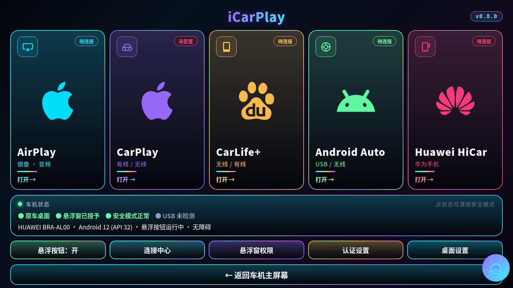
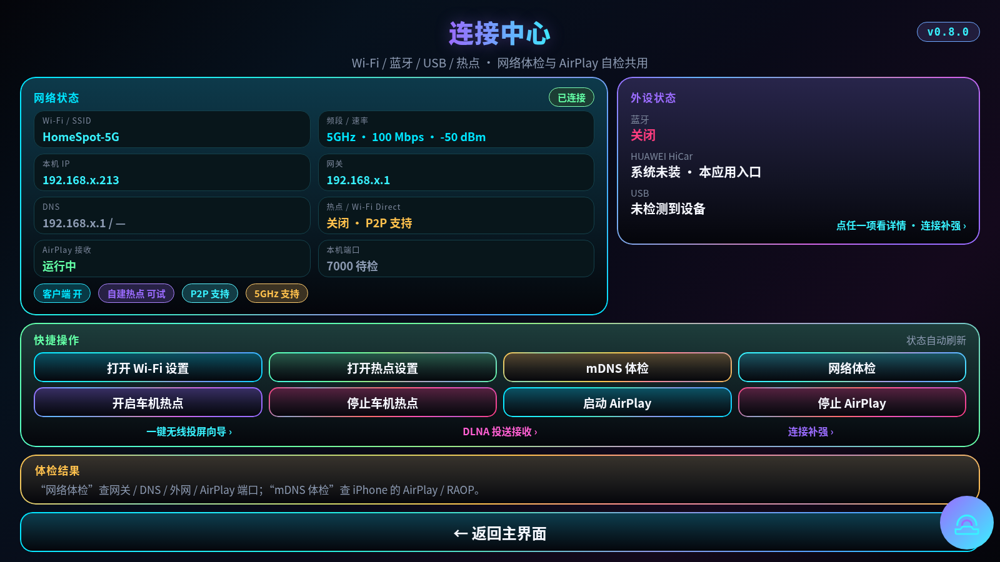
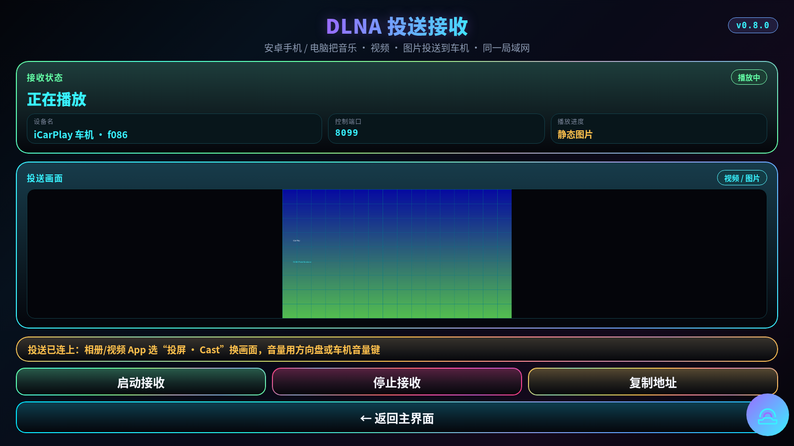
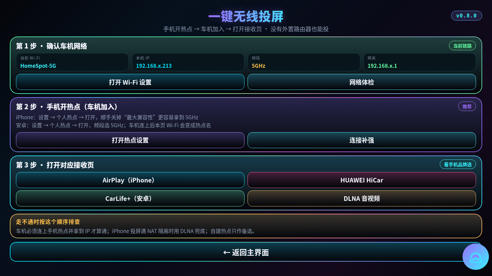

<div align="center">

# iCarPlay

**2020 款福特锐际 SYNC+ 车机的第三方互联中枢**
一个 APK，五种投屏入口 · 一套赛博朋克车机 UI

`v0.8.0`　·　`Android 8.1 / API 27`　·　`1920×720 · 1600×900`　·　`arm64-v8a + armeabi-v7a`

</div>

<div align="center">

[**下载 icarplay.apk**](https://github.com/RockJesus/icarplay/releases/latest/download/icarplay.apk)　·　[Releases](https://github.com/RockJesus/icarplay/releases)　·　[安装说明](docs/INSTALL.md)　·　[构建说明](docs/BUILD.md)　·　[安全边界](docs/SAFETY.md)

</div>

---

## 界面预览

<p align="center">
  
  
</p>
<p align="center">
  <em>首页 · 五个入口同屏，五张卡的品牌标居中放大、状态胶囊在右上角</em><br/>
  <em>连接中心 · 网络状态 / 外设状态 / 快捷操作 / 体检结果</em>
</p>

<p align="center">
  
  
</p>
<p align="center">
  <em>DLNA 投送接收 · 投送中把状态、画面、说明、按钮压进一屏</em><br/>
  <em>一键无线投屏 · 手机开热点 → 车机加入 → 打开接收页</em>
</p>

> 预览图按 **v0.8.0 的设计规格**（1600×900）等比渲染：色板、字号、卡片描边、品牌标与页面文案均取自仓库内同一份 UI 代码与资源，不是营销示意图；设备名、IP 等字段已替换为示例值。

## 它能做什么

| 入口 | 能力 | 现状 |
|---|---|---|
| **AirPlay** | iPhone / iPad / Mac 屏幕镜像与音频，控制中心直接选中 `iCarPlay` | 已接入，随首页启动默认开启 |
| **CarPlay** | 有线 / 无线入口、认证后端、USB 枚举与设置页 | 接入层完成，协议隧道未接入 |
| **CarLife+** | 百度 CarLife+ 兼容接收（有线 / 无线），接收核心内嵌在同一个 APK | 待真机复测 |
| **Android Auto** | USB AOA 有线条目 + 手机 Headunit Server 手动无线 | 协议已接通，待实车验证 |
| **Huawei HiCar** | 华为手机原生 HiCar 实验接收端，手机端不装第二个 APK | 实验路径（上游按 Android 10+ 设计） |

**首页是车机一屏布局**：五张主功能卡（AirPlay / CarPlay / CarLife+ / Android Auto / HiCar）+ 一行快捷操作 + 一行「返回车机主屏幕」，不需要下拉；宽度 ≥1100px 且宽高比 ≥1.5 的横屏（1600×900、1920×720）五卡同排，接近 4:3 的窄横屏自动 3+2 两行。

**车机 UI 统一为赛博朋克风格**：近黑极光背景、青 / 紫 / 粉 / 金霓虹强调色、1dp 彩虹渐变描边、紫→青渐变标题、状态胶囊与等宽仪表字；首页与所有二级页共用同一套设计令牌，页头标题居中、版本胶囊固定在右上角。

**内置悬浮按钮**：悬浮球由本 APK 自带，不需要第二个悬浮球 App。紫青渐变圆环、可拖动、位置限制在可视屏幕内；点按弹出 AirPlay / Android Auto / HiCar / CarPlay / 认证设置 / 系统设置 / iCarPlay 主界面 / 车机主屏幕，弹出菜单以外的任何位置点击即自动收起。车机桌面是系统层窗口，在系统「无障碍」里开启 `iCarPlay 悬浮按钮` 后改用无障碍悬浮层，才能显示在原车机桌面上（该服务只绘制悬浮球，不读取屏幕内容）。

## 没有外置路由器也能投

车机自带 Wi‑Fi，缺的只是一个能一起连的 AP。三种走法按可行性排序：

| 路径 | 怎么做 | 前提 |
|---|---|---|
| ① 手机开热点，车机加入 | 一键无线投屏向导第 2 步；iPhone 关掉“最大兼容性”更容易拿到 5GHz | 车机 Wi‑Fi 客户端可用（已确认） |
| ② 车机自建热点，手机连车机 | 连接中心「开启车机热点」 | Wi‑Fi 驱动支持 AP 模式，需实测 |
| ③ 有线兜底 | USB 数据线走 CarPlay / HiCar / Android Auto 有线路径 | USB 口支持 Host + 数据 |

配套的三个页面解决“连不上时到底卡在哪”：

- **连接中心** — Wi‑Fi / SSID / 频段与速率 / 本机 IP / 网关 / DNS / 热点与 Wi‑Fi Direct / AirPlay 端口一次看完，另有无线能力胶囊（客户端 / 自建热点 / P2P / 5GHz）、外设状态（蓝牙 / HiCar / USB），以及 `网络体检`（网关、DNS、外网、AirPlay 端口）与 `mDNS 体检`（iPhone 的 AirPlay / RAOP 广播）。
- **一键无线投屏向导** — 第 1 步确认车机链路，第 2 步手机开热点让车机加入，第 3 步按手机品牌直达对应接收页，末尾给“走不通时”的排查顺序。
- **DLNA 投送接收** — 手机相册 / 视频 App 选“投屏 · Cast”，把音乐、视频、图片推到车机；投送中状态卡、投送画面、单行说明与按钮压在同一屏，停止后画面卡自动清空、版式恢复。

## 能力矩阵

| 能力 | 状态 | 说明 |
|---|---|---|
| AirPlay 屏幕镜像 | ✅ | iOS / iPadOS / macOS 同网发现，H.264 / H.265 解码 |
| AirPlay 音频 | ✅ | AAC-ELD / AAC-LC / ALAC，AudioTrack 输出 |
| AirPlay 视频投放 | ✅ | HLS / 远程视频，播放控制 |
| Android Auto 有线（USB AOA） | ✅ 代码已接入 | 手机切 AOA 配件模式，进 AAP / TLS / H.264；需 USB Host + 数据口 |
| Android Auto 无线（Headunit Server） | ⚠️ 实验 | 手机开 Headunit Server，同一 Wi‑Fi，手动输入 IP:5277 |
| Huawei HiCar（华为手机） | ⚠️ 实验 | MIT 开源接收端；需手机原生 HiCar；上游按 Android 10+ 设计，8.1 未实车验证 |
| CarLife+ 兼容接收（有线 / 无线） | ⚠️ 待真机复测 | 内嵌 GPL-3.0 接收核心；不是百度官方车机端 SDK，不保证无感连接 / 原生小程序 |
| DLNA 投送接收（音频 / 视频 / 图片） | ✅ | SSDP 组播应答 + AVTransport / RenderingControl / ConnectionManager，同局域网即可 |
| 连接中心 / 网络体检 / mDNS 体检 | ✅ | 只读诊断，不调用系统命令、不改系统设置 |
| 内置悬浮按钮 | ✅ | 可拖动，点按弹出快捷菜单，点外部自动收起；开机仅恢复悬浮层 |
| CarPlay 有线 / 无线入口 | ⚠️ 骨架 | USB 枚举 / Wi‑Fi 状态 + 启动状态，协议引擎未接入 |
| CarPlay 认证后端 | ⚠️ 骨架 | 本地证书 / MFi 芯片 / 远程 MFI 三选一，仅保存与检查 |
| 车机安全约束 | ✅ | 不写系统分区、不申请设备管理员 / 系统设置权限、不抢占默认桌面 |
| 不需要第二个 APK | ✅ | 悬浮球、AirPlay、Android Auto、HiCar、CarPlay 入口、CarLife+、DLNA 都在同一个包里 |

## 安装（SYNC+ 车机）

1. U 盘格式 **FAT32**，把唯一的 `icarplay.apk` 放根目录；
2. 输入法漏洞进安卓原生设置 → 存储 → U 盘 → 安装；
3. 如果报 **“应用未安装”**，说明撞上 SYNC+ 的签名白名单，需要百度签名重签；
4. 装完桌面没有图标，从 **设置 → 应用 → iCarPlay → 打开** 进入；
5. 首次打开会自动弹出权限引导：允许悬浮窗，再依次允许麦克风、位置、蓝牙、通知和电池优化；悬浮按钮默认自动启动；
6. 首页点 CarLife+ → 有线 / 无线连接；DLNA 页点「启动接收」；Android Auto / HiCar 进入接收页；CarPlay 进入认证 / 连接页。

详细步骤与判读见 [`docs/INSTALL.md`](docs/INSTALL.md)。

## 各协议的边界

<details>
<summary><b>AirPlay</b></summary>

- 不需要 MFi，iPhone 控制中心选“屏幕镜像”即可发现 `iCarPlay`；
- 车机与 iPhone 必须在同一局域网（推荐外接 5GHz 路由，SYNC+ 自带热点 iPhone 搜不到）；
- **单向输出**：没有触控回传，不能在车机上反向控制 iPhone；
- DRM 内容（Netflix、Apple TV+）黑屏；
- 1920×720 是 8:3，16:9 的 iPhone 画面会留黑边。

</details>

<details>
<summary><b>Android Auto</b></summary>

- **有线是主路径**：USB 口必须支持 USB Host 和数据，手机必须安装 Android Auto；首次连接在手机上确认 USB 权限。手机切到 AOA accessory 模式后，`AndroidAutoUsbReceiver` 会直接启动协议服务。
- **无线是手动模式**：手机 Android Auto 开发者选项 → `Start headunit server`，手机与车机同一 Wi‑Fi，在车机里输入手机 IP，端口 `5277`。不做蓝牙 + Wi‑Fi Direct 自动握手（SYNC+ 上曾触发 Wi‑Fi Direct 重启循环）。
- **没有 GMS 不影响接收端**，但手机端 Android Auto 被厂商裁剪时仍然连不上。
- 详见 [`docs/ANDROID-AUTO.md`](docs/ANDROID-AUTO.md)。

</details>

<details>
<summary><b>Huawei HiCar</b></summary>

- 华为手机必须支持**原生 HiCar**（不是所有华为 / 荣耀机型都有），手机端不需要安装辅助 APK；
- 车机需要蓝牙 / BLE、WLAN 热点或 Wi‑Fi Direct；2020 款 SYNC+ Android 8.1 车机上属于**实验路径**，上游按 Android 10+ 设计，重启回连问题也未解决；
- 首次先在系统蓝牙里普通配对，再进 HiCar 页面点“开始连接”，按手机提示输入六位码；
- 详见 [`docs/HICAR.md`](docs/HICAR.md)。

</details>

<details>
<summary><b>CarPlay</b></summary>

- 需要 Apple MFi 认证身份，三选一：本地 `.p7b` + `.pk8`、MFi 芯片、远程 MFI 服务；
- 当前仓库只完成接入层，不含 iAP2 / MFi 握手 / CarPlay AirPlay 隧道；
- 没有认证材料时，`CarPlayActivity` 的有线 / 无线按钮只会返回“未配置认证”；
- 接入协议栈的路线见 [`docs/CARPLAY.md`](docs/CARPLAY.md)。

</details>

## 目录

```
icarplay/
├── app/
│   ├── src/main/kotlin/io/github/jqssun/airplay/   # 上游 AirPlay 引擎（原生单页 UI）
│   ├── src/main/java/com/rockjesus/icarplay/       # iCarPlay 壳层（首页 / 连接中心 / DLNA / 向导 / 悬浮按钮 / 认证设置）
│   ├── src/main/java/local/hicarlab/               # Huawei HiCar 实验接收端 + SafetyGuard
│   ├── src/main/java/info/anodsplace/headunit/     # Android Auto AAP/TLS/解码/触控协议层
│   ├── src/main/cpp/                               # UxPlay / FFmpeg / OpenSSL 原生栈
│   └── src/main/AndroidManifest.xml
├── docs/                                           # INSTALL / AIRPLAY / ANDROID-AUTO / HICAR / CARPLAY / CARLIFE-PLUS / SAFETY / BUILD
├── docs/preview/                                   # README 界面预览图（1600×900）
├── scripts/preflight-safety.sh                      # 发布前车机安全检查
├── scripts/render-preview.py                        # 预览图渲染脚本（HTML 复刻 → Chromium 截图）
├── .github/workflows/apk.yml                        # GitHub Actions 构建
└── README.md
```

## 构建

CI（推荐）：

```bash
gh workflow run apk.yml -R RockJesus/icarplay --ref main
```

构建前会运行 `scripts/preflight-safety.sh`；本机也可以先执行它。

本地构建需要 JDK 21、Android SDK 37、NDK `27.0.12077973`，并初始化子模块：

```bash
git submodule update --init --recursive
./gradlew assembleRelease
```

详见 [`docs/BUILD.md`](docs/BUILD.md)。

## 合规与来源

- 本仓库包含 **AGPL-3.0** 的 Android Auto 协议层，组合作品按 AGPL-3.0 分发；AGPL 全文见 [`LICENSE-AGPL-3.0.txt`](LICENSE-AGPL-3.0.txt)，来源与版权见 [`NOTICE`](NOTICE)。
- AirPlay 协议栈来自 [`jqssun/android-airplay-server`](https://github.com/jqssun/android-airplay-server)，其底层为 [`FDH2/UxPlay`](https://github.com/FDH2/UxPlay)，并保留上游版权与许可。
- Android Auto 协议层来自 [`harryjph/android-auto-headunit`](https://github.com/harryjph/android-auto-headunit)（AGPL-3.0），保留上游版权与许可；不含 Google 私有 Android Auto APK。
- Huawei HiCar 接收端来自 [`huducat586/hicar-android-receiver`](https://github.com/huducat586/hicar-android-receiver)（MIT，0.11.1 Preview）；原生库取自其官方 release APK，第三方许可证随包放在 `app/src/main/assets/hicar-licenses/`，来源见 [`THIRD_PARTY_NOTICES-HICAR.txt`](THIRD_PARTY_NOTICES-HICAR.txt)。
- CarLife+ 接收核心来自 [`FF1239/Limo-carlife`](https://github.com/FF1239/Limo-carlife)（GPL-3.0），详见 [`docs/CARLIFE-PLUS.md`](docs/CARLIFE-PLUS.md)。
- CarPlay 接入层的设计参考了 DiPlay / xcertplay / PlayPort 的公开架构，但**未包含**任何 Apple 认证材料、私钥或他人提取的配件身份。
- 本项目与 Apple、Ford、Baidu、Huawei 均无关联。

## 风险

- SYNC+ 有签名白名单，自签名包可能直接装不上；
- 主界面和接收服务默认不自启，仅悬浮按钮悬浮层开机恢复，避免 Wi‑Fi Direct 导致的重启循环；
- AirPlay 长期稳定性、音频通道、1920×720 适配仍需实车验证；
- 2020 款锐际的 Wi‑Fi 是否能自建热点、5GHz 与 mDNS 能否稳定发现 iPhone，以车机实测为准，连接中心与网络体检就是为此准备的。

<div align="center">

版本历史见 [Releases](https://github.com/RockJesus/icarplay/releases)

</div>
